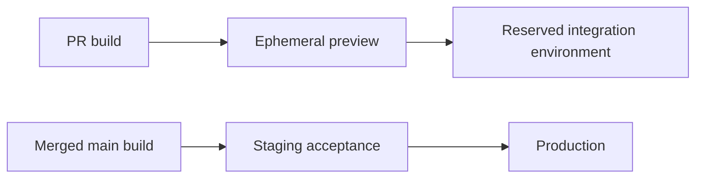

# ADR-0004: Separate release delivery from integration reservations

> Historical proposal: the implementation direction is now [verified release promotion](../verified-release-promotion.md). Separate integration reservations are not being implemented. This document is retained as design history, not the current rollout plan.

**Status:** Proposed
**Date:** 2026-09-24
**Deciders:** suparCloud maintainers

## Context

Developers need to reserve an environment for several days while testing a PR
against external services. Today, pinning that preview into staging blocks the
release path. Staging is being used both as the production acceptance gate and
as a long-lived integration sandbox.

The current implementation couples these uses:

- `internal/gitops/publisher.go` builds a linear Kargo chain from all bound,
  stable environments sorted by `Order`.
- `internal/server/auto_promote.go` skips pinned source environments and selects
  each preceding stable environment as the next environment's source.
- `internal/server/app_handler.go` selects manual promotion sources by order.
  It can publish a source image into the destination before Kargo accepts the
  promotion, and can report a GitOps fallback success when Kargo fails.
- `internal/kube/kargo_store.go` explicitly approves freight on normal
  promotion submission as a workaround for verification availability.
- `internal/app/promotion.go` permits preview-to-stable release copies in its
  store path. That path also needs the release policy, not only the HTTP UI.

Adding an environment named `integration` alone would insert another member
into the existing chain. Removing the pinned-source guard would not establish
that a production candidate passed acceptance testing.

## Decision

Adopt this default delivery path:

Staging remains the production acceptance environment. Integration is a stable,
reservable deployment target outside the release pipeline. A successful PR test
does not authorize production deployment: the merged release must pass staging.

This is a Suparship golden path aligned with CNCF continuous-delivery guidance
and OpenGitOps principles, not a claim that CNCF specifies a mandatory topology
or a certification named "GitOps golden path".

### Environment participation

Introduce explicit environment delivery configuration, separate from `EnvType`
(currently a UI hint), `Order`, and app-wide `DeliveryMode`:

- **Pipeline:** has a configured source: the release Warehouse for staging, or
  an upstream pipeline environment for production.
- **Integration:** accepts explicit release reservations and is excluded from
  Kargo release subscriptions and automatic promotion.
- **Preview:** retains the existing ephemeral lifecycle and cannot feed the
  production pipeline.

These are proposed semantics, not an existing API schema. The first version
needs one upstream per pipeline environment; arbitrary multi-source graphs are
out of scope. Validate missing sources, cycles, and integration/preview sources
on every configuration write. Disabling an upstream must block its dependents,
not silently reconnect production directly to the Warehouse.

Use one shared policy resolver for publishing, manual promotion, automatic
promotion, stack operations, and UI eligibility. In the explicit model `Order`
controls display only. Keep app-wide direct delivery for external software;
do not convert a whole pipeline app to direct delivery to support its sandbox.

### Immutable releases and GitOps ownership

CI builds and tests the merged commit once, publishes immutable image digests,
and records source/build provenance. A release identifies all component image
digests plus versioned chart and common configuration inputs. Promote those
same digests through staging to production without rebuilding. Tags may remain
display labels; mutable tag resolution cannot establish release identity.

Environment-specific settings and secret references stay external to the image
and versioned where appropriate. Record the staging configuration revision with
verification results; material changes require revalidation. Secrets themselves
must not be committed to Git.

Git contains desired deployment state. Kargo changes pipeline desired state;
Argo CD pulls and reconciles it. Suparship submits policy-checked requests and
publishes integration reservation state through Git. There must be a single
writer for each environment's release selection: ordinary app republishing
must preserve Kargo's selected pipeline release.

### Production eligibility

The normal production path requires:

1. A release from the permitted main-branch build pipeline, identified by digest.
2. Successful staging reconciliation for that release and configuration.
3. Successful explicit acceptance verification, including required integration
   tests; Argo CD `Healthy` alone is insufficient.
4. The configured production authorization policy (manual approval by default).

Represent verification with Kargo Stage verification/AnalysisTemplates and
retain release-specific evidence. Select an eligible release explicitly for
manual promotion, rather than assuming the current staging occupant is the
only candidate. Previously verified releases remain eligible subject to
revocation, configuration compatibility, and any configured freshness policy.
Automatic promotion must use a deterministic release ordering and must never
implicitly downgrade production to older eligible freight.

Normal promotion must not call Kargo's explicit freight-approval override to
bypass verification. Check eligibility before any deployable destination Git
change. First-deployment scaffolding must not activate an unverified release.
Missing freight, failed verification, unavailable Kargo, or authorization failure
must leave production's desired release unchanged. Disable the existing
publish-first/GitOps-success fallback for protected pipeline environments.

Rollback and emergency promotion remain separate, permission-controlled,
audited operations with an explicit reason. A rollback selects a known prior
release and accounts for configuration/database compatibility. Neither action
is an implicit fallback from a failed normal promotion. Keep rollback holds
separate from preview reservations even though both currently use `PinnedFrom`.

### Integration reservations

Allow developers to reserve integration for a preview release with a stable
hostname, dedicated secret references, and isolated data/external-service tenant.
Record owner, reason, source preview, immutable release, start time, and optional
expiry. Owners can renew reservations for multi-day tests. Conflicting writes
must fail or require an explicit authorized takeover.

Snapshot the reserved release independently of the preview: PR updates and
preview deletion must not change or delete the reservation. A requested update
to the reservation is a new audited Git change. Expiry marks the reservation
as expired and alerts its owner; it does not silently replace the workload.
Explicit release restores a configured integration baseline or undeploys it,
as chosen when the environment is configured.

Reject new preview pins into staging and production under the golden path,
both in APIs and in the UI. Present "Reserve integration" for that workflow.
Production rollback holds remain available through the dedicated rollback flow.
Stack reservations must report member outcomes and must not claim cross-app
runtime atomicity; each app remains its own release unit under ADR-0002.

Namespaces alone do not isolate external services. If a provider offers only
one test tenant and all production candidates require it, provision another
tenant or schedule exclusive access. Required tests remain blocking until they
can run; this architecture cannot remove that external constraint.

## Options considered

| Option | Complexity / cost | Assessment |
|--------|-------------------|------------|
| Keep one staging and schedule reservations | Low implementation and infrastructure cost | Preserves the existing bottleneck; incompatible with concurrent release delivery |
| Allow production to skip staging when pinned | Low initial implementation cost | Loses the acceptance guarantee; rejected as the normal path |
| Separate integration from staging | Moderate implementation and additional workload/provider cost | Chosen; stable integration endpoints and independent release throughput |
| Use only ephemeral previews for integration | Lower persistent capacity, more endpoint/tenant automation | Useful when providers support it; insufficient for existing long-lived endpoint reservations |

The chosen path keeps the familiar staging-to-production workflow and existing
Argo CD/Kargo components. It adds capacity and policy complexity but removes
the shared deployment slot as a routine release bottleneck.

## Consequences and scope

- Release delivery continues while integration holds an unrelated PR release.
- Integration cannot become a production source accidentally through ordering.
- Removing the freight-approval workaround requires validating the installed
  Kargo version and its verification behavior before enforcement.
- A provider tenant shared with staging can still serialize required tests.
- Production canary rollout is compatible future work, not required to fix
  environment reservation coupling.
- This ADR does not change deployed resources or promise these APIs exist today.

## Migration strategy and action items

Follow [the phased migration and acceptance plan](../release-pipeline-migration.md).

- [ ] Add explicit environment participation and a shared source-policy resolver.
- [ ] Add integration reservations and API/UI enforcement across app and stack paths.
- [ ] Add immutable release identity and staging verification gates.
- [ ] Remove approval bypasses and pre-gate production writes in protected mode.
- [ ] Migrate active staging reservations without interrupting external tests.
- [ ] Enable the golden path after the acceptance scenarios pass.

## References

- [CNCF: Continuous Delivery](https://glossary.cncf.io/continuous-delivery/)
  describes automated delivery into acceptance environments.
- [OpenGitOps principles](https://opengitops.dev/) define declarative, versioned
  and immutable, automatically pulled, continuously reconciled desired state.
- [CNCF supply-chain best practices](https://contribute.cncf.io/projects/best-practices/security/supply-chain/supply-chain-best-practices/)
  describe automated pipeline and artifact provenance practices.
- [Kargo verification](https://docs.kargo.io/user-guide/how-to-guides/verification)
  documents downstream eligibility, analysis, and explicit approval bypasses.
