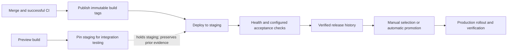

# ADR-0005: Promote verified releases independently of staging pins

**Status:** Accepted for implementation; public rollout validation remains incomplete.
**Date:** 2026-10-18
**Supersedes:** [ADR-0004](0004-release-pipeline-and-integration-reservations.md).

## Context

A team can pin staging to a preview while testing an external integration for
several days. Previously, production promotion depended on staging's current
occupant. Restoring staging first introduced another GitOps reconciliation and
rollout even when the desired release had already passed staging verification.

A mandatory integration environment adds infrastructure and requires teams to
move external callbacks. We need an environment-independent rule that preserves
verification without imposing that topology. CNCF and GitOps principles do not
prescribe a mandatory environment topology or a certified "golden path".

## Decision

Keep the ordered environment pipeline. Treat a pin as a hold on its destination,
and use Kargo Freight's recorded upstream verification to select a release.

An already verified release remains eligible when staging is pinned to a
preview. A newly built release still needs staging verification; this decision
does not create extra validation capacity. Production holds and decommissioned
targets continue to block promotion into that target.

### Evidence and execution

Suparship checks the Freight's Warehouse origin, source verification, and the
target's upstream policy. Approval alone is not verification. Kargo rechecks
eligibility, executes the Git write, and runs its configured verification.

A first deployment prepares inactive target manifests. The selected image and
target activation enter Git together through the Promotion. The UI distinguishes
an applied promotion from a healthy, verified rollout.

### Scheduler ownership

Kargo schedules Warehouse-to-first-Stage delivery. Suparship schedules downstream
automatic promotion, including target preparation. Before scheduling, Suparship
requires a live, explicit disabled Kargo policy for that target and a Stage
refresh acknowledgement tied to the ProjectConfig resourceVersion. A Git push
or startup republish alone does not complete the handoff.

Read failures, missing configuration, and ambiguous earlier selectors pause the
scheduler. The gate does not consume a promotion retry cooldown. Manual verified
promotion continues through its separate eligibility checks.

### Ordering and concurrent requests

Releases and rollbacks use Kargo-compatible `stage.ULID.freight` names. Kargo
compares these names lexically, so a private prefix or an unpadded counter can
make a completed deployment disappear from the Stage's latest-operation view.

A `suparship.io/promotion-reservation` Stage annotation reserves a name for the
observed predecessor. Kubernetes resourceVersion conflicts resolve concurrent
Suparship callers onto the same reservation. It survives server restarts and
crashes before Promotion creation. Kargo's own clients share the naming format,
but do not participate in this reservation; Kargo queues their operations.

## Consequences

- Existing staging URLs and pins remain usable; no new environment is required.
- Automatic selection follows Freight discovery order, not Git ancestry. CI must
  publish immutable main-branch build tags only after its checks pass.
- Changing acceptance policy does not invalidate historical verification.
  Operators must reverify or remove obsolete evidence when changing policy.
- New unverified releases wait while staging is held. Teams needing concurrent
  validation must provide additional capacity through their own pipeline design.
- Image tags are not replaced with enforced digest pinning by this change.
- Direct-delivery apps and the local fake provider retain their existing paths.

## Migration and validation

Generator v0.4.0 republishes the stable-environment manifests. Upgrade the chart
permissions as well as the server, and verify the live ApplicationSet templates
and scheduler handoff. Normal released timestamp-based Promotion names remain
ordered before native names; experimental `verified-*` history requires separate
attention and is rejected when it would outrank a new operation.

See the [upgrade runbook](../verified-release-upgrade.md),
[user and API guide](../verified-release-promotion.md), and
[test evidence and remaining limits](../verified-release-e2e.md).
